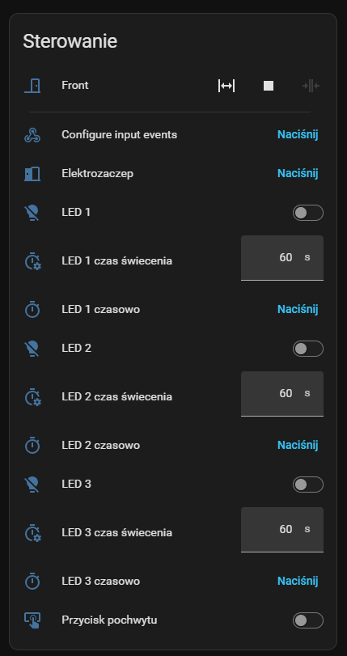
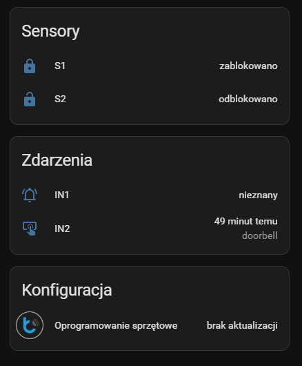

# WIKĘD Smart 2.0 for Home Assistant

Local integration extension for WIKĘD Smart 2.0 door controllers (BleBox `doorUnitBox_v2`).

**Version 0.1.3 — beta.** Independent community project; not affiliated with WIKĘD, BleBox or Home Assistant.

## Why this project exists

WIKĘD Smart 2.0 is a **smart entrance door controller, not just a gate controller**. The standard Home Assistant BleBox integration treats its `gateBox` device type as a generic cover, exposing basic open/close control and position/status, while the door-specific lighting, handle setting and additional inputs are not exposed as dedicated entities.

This project started with a simple goal: **control the three built-in door LED circuits directly from Home Assistant.** It has grown into a door-specific extension with independent lighting, native timed lighting commands, lock signals, handle control and physical button events — all through the local device API.

## Before and after

| Capability | Standard BleBox integration | WIKĘD extension |
| --- | --- | --- |
| Device representation | Generic gate/cover | WIKĘD Smart 2.0 door controller with dedicated entities |
| Basic gate/cover control and status | Yes | Retained for compatibility |
| LED 1, LED 2, LED 3 | Not exposed | Three independent light entities |
| Timed LED activation | Not exposed | Three timed-light buttons, each with its own 1–3600 s duration |
| Handle button enable/disable | Not exposed | Dedicated switch |
| Electromechanical release | Generic cover operation | Dedicated release button (opt-in) |
| S1 lock signal | Generic cover position/status | Dedicated lock binary sensor |
| S2 lock signal | Not exposed | Dedicated lock binary sensor |
| IN1 and IN2 button events | Not exposed | Dedicated event entities with explicit automatic action provisioning |
| Firmware update | Yes | Retained |

The legacy cover is retained, not renamed or replaced; S1 and S2 do not establish whether the door leaf is physically closed. LED outputs are on/off, not dimmable. See the validation section for the current hardware test coverage.

## Features

| Entity | Function |
| --- | --- |
| Light | Three independently controlled LED outputs (on/off) |
| Number / button | Individual timed lighting, 1–3600 seconds |
| Switch | Enable or disable native handle release |
| Binary sensor | S1 and S2 lock signals |
| Button | Native door release (disabled by default) |
| Event | IN1 and IN2 physical input events |
| Button | Configure input events on the controller |

The native cover and firmware update entities are retained. The extension activates only for the exact advertised WIKĘD product. No cloud account is required for the local integration.

## Home Assistant screenshots

Real device page from a working WIKĘD Smart 2.0 installation (Polish Home Assistant interface). The original generic cover is retained for compatibility.

<table>
  <tr>
    <th>Door and lighting controls</th>
    <th>Lock sensors, input events and firmware</th>
  </tr>
  <tr>
    <td valign="top"></td>
    <td valign="top"></td>
  </tr>
</table>

The images show the actual installation after adding the extension. The original interface is described in the comparison table above; no reconstructed before screenshot is used.

## Compatibility and validation

Tested installation: Home Assistant Core 2026.11.3, W-dU-2.0 hardware, firmware 0.1060.

- IN2: seven end-to-end events verified, including both handle modes.
- S1: mechanical key state changes verified.
- LED switching and timed commands: verified in wBox traffic.
- IN1 physical delivery, S2 transitions, HA release button and operation during HA downtime: not independently verified.
- No LED dimming support has been established.

S1 and S2 are lock signals, not proof that the door leaf is closed. Wiring varies between installations.

## Installation

This beta is an overlay of the native BleBox integration, not a standalone HACS integration. It copies the matching native integration and adds WIKĘD support in `/config/custom_components/blebox`. It refuses to overwrite an unrelated custom component.

1. Back up Home Assistant and the controller action inventory.
2. Copy [blebox_wiked_install_0.1.3.py](blebox_wiked_install_0.1.3.py) to `/config`.
3. Run in the HA Terminal & SSH add-on (Python 3 is required; on Alpine, install with `apk add --no-cache python3` if needed):

```sh
python3 /config/blebox_wiked_install_0.1.3.py && ha core check && ha core restart
```

For an existing WIKĘD overlay:

```sh
python3 /config/blebox_wiked_install_0.1.3.py --upgrade && ha core check && ha core restart
```

The previous overlay is backed up. The overlay takes precedence over the built-in integration and persists across Core updates. Recheck compatibility after updating Core. Keep working native controls until their replacements are validated.

## Physical input events

Open the WIKĘD device in Home Assistant and press **Configure input events** once. The integration allocates two free action slots and verifies the configuration after each write. Existing user actions, including native conditional release, are preserved. Installation and startup do not write action configuration.

| Input | Handle setting | Event type |
| --- | --- | --- |
| IN1 | Any | `doorbell` |
| IN2 | Disabled | `doorbell` |
| IN2 | Enabled | `pressed` |
| IN2 | Unknown | `pressed_unknown` |

The event entities initially have an unknown state until an event arrives. The device must be able to reach HA's local HTTP address. Webhooks use persistent random identifiers and accept local GET requests. The handle state is read at event reception, not atomically at the input edge.

Events never issue a door release command. Native release remains controlled by the original device action. A hidden handle button is not a substitute for a publicly accessible doorbell.

## Removal and recovery

Before removing the overlay, remove only its two managed URL actions (`HA IN1` and `HA IN2`) in wBox, verifying their webhook URLs. Do not remove native OPEN or other user actions. The installer does not remove actions from the device.

```sh
python3 /config/blebox_wiked_install_0.1.3.py --remove && ha core check && ha core restart
```

The removed overlay is retained in `/config/blebox_wiked_removed`; removal stops if that backup directory already exists. The built-in integration loads on restart.

## Development

```sh
python3 -m unittest discover -s tests -v
```

Offline tests cover parsing, entity state mapping, action allocation, preservation, idempotency and overwrite protection. They do not replace hardware tests.

- [Local API observations](docs/API.md)
- [Changelog](CHANGELOG.md)
- [Security policy](SECURITY.md)
- [Upstream BleBox issue #210](https://github.com/blebox/blebox_uniapi/issues/210)

## License

Apache-2.0. See [LICENSE](LICENSE) and [NOTICE](NOTICE). The installer obtains the matching Home Assistant integration from the installed Core or the official source; upstream code retains its original license and attribution.
