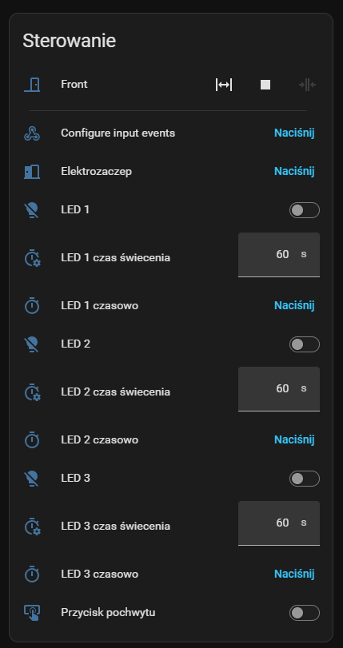
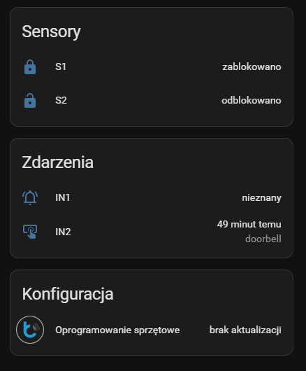

# WIKĘD Smart 2.0 dla Home Assistanta

[English](README.md) · **Polski**

Rozszerzenie lokalnej integracji BleBox, przeznaczone dla sterowników drzwi wejściowych WIKĘD Smart 2.0 (`doorUnitBox_v2`).

**Najnowsza wersja beta sprawdzona na sprzęcie: 0.1.3.** Wersja 0.1.5 jest kandydatem rozwojowym z tłumaczeniami PL/EN i poprawką regresji nazw encji zaobserwowanej w 0.1.4. Poprawkę obejmują testy offline; pozostaje sprawdzenie na rzeczywistej instalacji. Niezależny projekt społecznościowy, niepowiązany z producentami WIKĘD i BleBox ani z projektem Home Assistant.

## Dlaczego powstał ten projekt?

WIKĘD Smart 2.0 to **sterownik inteligentnych drzwi wejściowych, a nie zwykły sterownik bramy**. Standardowa integracja BleBox w Home Assistancie traktuje urządzenie typu `gateBox` jako encję bramy (cover). Udostępnia podstawowe sterowanie i stan, ale nie prezentuje oświetlenia drzwi, ustawienia przycisku pochwytu ani dodatkowych wejść jako dedykowanych encji.

Projekt rozpoczął się od prostego celu: **niezależnego sterowania trzema obwodami oświetlenia LED w drzwiach bezpośrednio z Home Assistanta**. Z czasem objął także czasowe włączanie oświetlenia, sygnały zamka, sterowanie przyciskiem pochwytu i zdarzenia z wejść fizycznych. Wszystko za pośrednictwem lokalnego API sterownika.

## Porównanie ze standardową integracją

| Funkcja | Standardowa integracja BleBox | Rozszerzenie WIKĘD |
| --- | --- | --- |
| Rozpoznanie urządzenia | Ogólna encja bramy (cover) | Sterownik drzwi WIKĘD Smart 2.0 z dedykowanymi encjami |
| Podstawowe sterowanie i stan | Tak | Zachowane dla kompatybilności |
| LED 1, LED 2, LED 3 | Niedostępne | Trzy niezależne encje światła |
| Czasowe włączanie LED | Niedostępne | Trzy przyciski z indywidualnym czasem 1–3600 s |
| Włączenie i wyłączenie przycisku pochwytu | Niedostępne | Dedykowany przełącznik |
| Zwolnienie elektrozaczepu | Ogólna operacja otwierania bramy | Dedykowany przycisk (domyślnie wyłączony) |
| Sygnał zamka S1 | Pozycja/stan encji bramy | Dedykowany sensor binarny zamka |
| Sygnał zamka S2 | Niedostępny | Dedykowany sensor binarny zamka |
| Zdarzenia IN1 i IN2 | Niedostępne | Dedykowane encje zdarzeń i konfiguracja akcji na żądanie |
| Aktualizacja oprogramowania sprzętowego | Tak | Zachowana |

Dotychczasowa encja bramy pozostaje bez zmian. Sygnały S1 i S2 nie potwierdzają fizycznego domknięcia skrzydła drzwi. Wyjścia LED obsługują włączanie i wyłączanie, bez regulacji jasności. Zakres potwierdzonych testów sprzętowych podano poniżej.

## Dostępne encje

| Typ encji | Funkcja |
| --- | --- |
| Światło (light) | Trzy niezależne wyjścia LED (włącz/wyłącz) |
| Liczba i przycisk (number, button) | Indywidualne czasowe włączanie oświetlenia, 1–3600 s |
| Przełącznik (switch) | Włączenie lub wyłączenie natywnej funkcji przycisku pochwytu |
| Sensor binarny (binary_sensor) | Sygnały zamka S1 i S2 |
| Przycisk (button) | Zwolnienie elektrozaczepu (domyślnie wyłączony) |
| Zdarzenie (event) | Zdarzenia z fizycznych wejść IN1 i IN2 |
| Przycisk (button) | Konfiguracja zdarzeń wejściowych w sterowniku |

Natywne encje bramy i aktualizacji oprogramowania pozostają dostępne. Rozszerzenie aktywuje się wyłącznie dla rozpoznanego modelu sterownika WIKĘD. Integracja lokalna nie wymaga konta w chmurze.

## Jak to wygląda w Home Assistancie?

Rzeczywista strona urządzenia w działającej instalacji WIKĘD Smart 2.0. Dotychczasowa encja bramy została zachowana dla kompatybilności.

<table>
  <tr>
    <th>Sterowanie drzwiami i oświetleniem</th>
    <th>Sygnały zamka, zdarzenia i oprogramowanie</th>
  </tr>
  <tr>
    <td valign="top"></td>
    <td valign="top"></td>
  </tr>
</table>

Zrzuty pokazują rzeczywisty stan po zainstalowaniu rozszerzenia. Różnice względem standardowej integracji opisano w tabeli powyżej. W tej wersji beta nazwy encji nie są jeszcze w pełni zlokalizowane — część występuje po polsku, a część po angielsku. Kandydat 0.1.5 zawiera natywne zasoby tłumaczeń HA; zrzuty przedstawiają wersję 0.1.3.

## Kompatybilność i zakres testów

Instalacja testowa: Home Assistant Core 2026.11.3, sterownik W-dU-2.0, oprogramowanie sprzętowe 0.1060.

- **IN2:** potwierdzono siedem zdarzeń od sterownika do Home Assistanta, w obu trybach pracy przycisku pochwytu.
- **S1:** potwierdzono zmiany stanu podczas używania klucza mechanicznego.
- **LED:** polecenia włączania, wyłączania i pracy czasowej zweryfikowano w ruchu sieciowym aplikacji wBox.
- **Elektrozaczep:** właściciel instalacji potwierdził 26 listopada 2026 r., że naciśnięcie dedykowanego przycisku w Home Assistancie uruchamia elektrozaczep i zwalnia drzwi.
- **IN1 i S2:** obsługiwane przez integrację i objęte testami offline; nie odnotowano odrębnego testu fizycznego zdarzenia IN1 ani zmiany stanu S2. Nie potwierdzono niezależnie działania podczas niedostępności HA.
- Nie potwierdzono możliwości regulacji jasności LED.

S1 i S2 są sygnałami zamka, a nie potwierdzeniem fizycznego zamknięcia skrzydła. Sposób podłączenia może się różnić w poszczególnych instalacjach.

## Instalacja

Wersja beta działa jako nakładka na natywną integrację BleBox, a nie jako samodzielna integracja HACS. Instalator kopiuje wersję natywnej integracji odpowiadającą zainstalowanemu Core i rozszerza ją o obsługę WIKĘD w katalogu `/config/custom_components/blebox`. Odmawia nadpisania innego komponentu niestandardowego.

1. Wykonaj kopię zapasową Home Assistanta oraz zapisz konfigurację akcji sterownika.
2. Pobierz plik `blebox_wiked_install_0.1.3.py` z [wydania v0.1.3 beta](https://github.com/krupaw2/blebox-wiked/releases/tag/v0.1.3-beta) i skopiuj go do `/config`.
3. Uruchom polecenie w dodatku Terminal & SSH (wymagany Python 3; w systemie Alpine można go doinstalować poleceniem `apk add --no-cache python3`):

```sh
python3 /config/blebox_wiked_install_0.1.3.py && ha core check && ha core restart
```

Aktualizacja istniejącej nakładki WIKĘD:

```sh
python3 /config/blebox_wiked_install_0.1.3.py --upgrade && ha core check && ha core restart
```

Poprzednia wersja nakładki zostaje zachowana jako kopia zapasowa. Nakładka ma pierwszeństwo przed wbudowaną integracją i pozostaje aktywna po aktualizacji Core. Po każdej aktualizacji Core sprawdź kompatybilność. Zachowaj działające natywne elementy sterowania do czasu potwierdzenia poprawnego działania ich odpowiedników.

## Zdarzenia z wejść fizycznych

Na stronie urządzenia WIKĘD w Home Assistancie naciśnij przycisk **Configure input events**. Integracja przydziela wolne lub wykorzystuje ponownie dwa zarządzane miejsca na akcje i po każdym zapisie odczytuje konfigurację w celu jej weryfikacji. Istniejące akcje użytkownika, w tym natywne warunkowe zwalnianie elektrozaczepu, są z założenia zachowywane. Jeśli zapis się powiedzie, ale późniejsza weryfikacja lub kolejny zapis zakończy się błędem, jedna zarządzana akcja może pozostać skonfigurowana; przed ponowieniem sprawdź listę akcji. Instalacja i uruchomienie integracji nie zapisują konfiguracji akcji.

| Wejście | Ustawienie przycisku pochwytu | Typ zdarzenia |
| --- | --- | --- |
| IN1 | Dowolne | `doorbell` |
| IN2 | Wyłączony | `doorbell` |
| IN2 | Włączony | `pressed` |
| IN2 | Nieznane | `pressed_unknown` |

Początkowy stan encji zdarzenia jest nieznany do czasu odebrania pierwszego zdarzenia. Sterownik musi mieć dostęp do lokalnego adresu HTTP Home Assistanta. Webhooki wykorzystują trwałe, losowe identyfikatory i przyjmują lokalne żądania GET. Ustawienie pochwytu odczytywane jest w chwili obsługi zdarzenia, a nie atomowo w chwili zmiany stanu fizycznego wejścia.

Zdarzenia nigdy nie wysyłają polecenia zwolnienia elektrozaczepu. Natywne zwalnianie pozostaje obsługiwane przez oryginalną akcję sterownika. Ukryty przycisk pochwytu nie zastępuje ogólnodostępnego dzwonka.

## Odinstalowanie i przywracanie

Przed usunięciem nakładki usuń w aplikacji wBox wyłącznie dwie zarządzane akcje URL (`HA IN1` i `HA IN2`), po sprawdzeniu adresów webhooków. Nie usuwaj natywnej akcji OPEN ani innych akcji użytkownika. Instalator nie usuwa akcji ze sterownika.

```sh
python3 /config/blebox_wiked_install_0.1.3.py --remove && ha core check && ha core restart
```

Usunięta nakładka pozostaje w katalogu `/config/blebox_wiked_removed`. Jeśli katalog kopii zapasowej już istnieje, operacja zostaje przerwana. Po ponownym uruchomieniu Home Assistanta ładowana jest wbudowana integracja.

## Rozwój i testy

Czytelny kod źródłowy znajduje się w katalogu [`src/`](src/). Skrypt [`scripts/build_installer.py`](scripts/build_installer.py) generuje jednoplikowy instalator kandydata 0.1.5. Dotychczasowe wydanie 0.1.3 pozostaje niezmienione. Kandydat zachowuje identyfikatory unikatowe encji i identyfikatory zdarzeń; nazwy wyświetlane mogą zależeć od języka Home Assistanta lub ustawień użytkownika. Nie instaluj kandydata na drzwiach istotnych dla bezpieczeństwa bez walidacji sprzętowej.

```sh
python3 scripts/build_installer.py --check
```

```sh
python3 -m unittest discover -s tests -v
```

Testy offline obejmują analizę odpowiedzi API, mapowanie stanów encji, przydzielanie miejsc na akcje, zachowywanie istniejących akcji, powtarzalność konfiguracji i ochronę przed nadpisaniem innych komponentów. Nie zastępują testów sprzętowych.

- [Obserwacje lokalnego API](docs/API.pl.md)
- [Historia zmian](CHANGELOG.pl.md)
- [Zasady bezpieczeństwa](SECURITY.pl.md)
- [Zgłoszenie w projekcie BleBox #210](https://github.com/blebox/blebox_uniapi/issues/210)

## Licencja

Apache-2.0. Zobacz [LICENSE](LICENSE) i [NOTICE](NOTICE). Instalator pobiera odpowiednią wersję integracji Home Assistanta z zainstalowanego Core lub z oficjalnych źródeł. Kod źródłowy projektów bazowych zachowuje swoją licencję i informacje o autorstwie.
